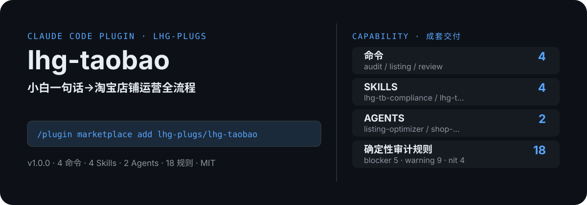

<!-- About 简介（推送后填写到仓库 About 栏）：
小白一句话→淘宝店铺运营全流程：选品、上架、标题/主图优化、数据复盘，方法论与检查清单一次配齐（平台规则变化快，不承诺实时数据、流量与排名效果）。 ｜ 一键安装：/plugin marketplace add lhg-plugs/lhg-taobao
-->
<!-- topics（推送后打）：claude-code, claude-plugin, agent-skills, taobao, ecommerce, listing, title-seo, product-image -->

<p align="center">
  
</p>

> **一句话介绍**：小白一句话→淘宝店铺运营全流程：选品、上架、标题/主图优化、数据复盘，方法论与检查清单一次配齐（平台规则变化快，不承诺实时数据、流量与排名效果）。

**一键安装**：在 Claude Code 里运行

```bash
/plugin marketplace add lhg-plugs/lhg-taobao
/plugin install lhg-taobao@lhg-plugs
```

## 它能帮你做出什么

每条产出先过确定性脚本自查，再交人工复核清单——数字全部数自仓库里的审计脚本，不靠模型"自觉"。

| 自查脚本 | 规则数 | blocker | warning | nit | 覆盖 |
|---|---|---|---|---|---|
| `scripts/audit/taobao_audit.py` | 18 | 5 | 9 | 4 | 标题、主图、SKU、详情页、价格、合规、格式 |
| **合计** | **18** | **5** | **9** | **4** | |

- **零 LLM 成本**：规则是纯 Python 脚本，零第三方依赖，本地运行。
- **坏 / 好对照可验**：`fixtures/` 里备有坏/好用例，冒烟测试断言命中情况。
- **冒烟全绿**：`python3 smoke_test.py` 44 项全部通过（JSON 合法、frontmatter 完整、命令/skill/agent 齐全）。

## 它是什么

`lhg-taobao` 是一个 Claude Code 插件（plugin 为主、skill 为辅）：

- **4 个命令**（小白入口）：`audit` 店铺体检、`listing` 单品打磨、`review` 数据复盘、`taobao` 一句话跑通淘宝店铺运营
- **4 个平台中立 skill**（方法论，可移植到豆包/Workbuddy 等 agent 平台）：lhg-tb-compliance, lhg-tb-listing, lhg-tb-review, lhg-tb-select
- **2 个专家 agent**：listing-optimizer, shop-auditor
- **2 个 hooks**（`hooks/`：post_write_warn.py, pre_commit_audit.py），关键操作前自动把关
- **18 条确定性自查规则**：纯 Python 脚本，见上表

## 为什么是它

不是一个 prompt，而是一套互相兜底的机制：

1. **确定性脚本（机器）+ 人工复核清单（人）**：先跑 `scripts/` 下的审计脚本（共 18 条规则），发现分三级：**blocker**（必须修）、**warning**（修或写豁免理由）、**nit**（顺手修）；再按对应 skill 的复核清单过一遍脚本抓不到的（内容真实性、越权、口径一致）。blocker 清零才算做完；为清零改规则算作弊，不许。
2. **硬门，不是提醒**：hooks 在关键操作前自动拦截或警告（见 `hooks/`），而不是只在文档里写一句"请注意"。
3. **方法论沉淀在 skill 里**：流程、检查清单、口径都写在 `skills/` 的方法论里，命令只是入口；换个 agent 平台也能复用同一套做法。
4. **可验，不是可信**：`fixtures/` 备有坏/好对照用例，`smoke_test.py` 一键验证，规则有没有生效、自己跑一遍就知道。

## 快速上手

```bash
# 1. 安装（Claude Code 里运行）
/plugin marketplace add lhg-plugs/lhg-taobao
/plugin install lhg-taobao@lhg-plugs

# 2. 一句话跑通淘宝店铺运营：选品→上架→标题/主图优化→数据复盘，方法论与检查清单一
/lhg-taobao:taobao "陶瓷马克杯"
```

| 命令 | 作用 | 示例 |
|---|---|---|
| `/lhg-taobao:audit` | 店铺体检：18 条确定性规则扫描店铺资产（标题/主图/SKU/详情页/价格/合规）… | `/lhg-taobao:audit ./taobao-pack` |
| `/lhg-taobao:listing` | 单品打磨：标题→主图→SKU→详情页逐项落实（字数/合规/尺寸/属性/模块），改完必须跑审计。 | `/lhg-taobao:listing "陶瓷马克杯"` |
| `/lhg-taobao:review` | 数据复盘：曝光→点击→转化漏斗定位问题，输出归因与改进行动清单（只做归因建议，不编造数据、不承诺效果）。 | `/lhg-taobao:review 周 "马克杯"` |
| `/lhg-taobao:taobao` | 一句话跑通淘宝店铺运营：选品→上架→标题/主图优化→数据复盘，方法论与检查清单一次配齐（不承诺流量与排名效果）。 | `/lhg-taobao:taobao "陶瓷马克杯"` |

## 什么时候用 / 什么时候不用（FAQ）

**什么时候用：**

- 你需要店铺体检时 → 用 `/lhg-taobao:audit`
- 你需要单品打磨时 → 用 `/lhg-taobao:listing`
- 你需要数据复盘时 → 用 `/lhg-taobao:review`

**什么时候不用：**

- 你只需要其中一个零散能力时 → 本插件是成套流程，单点需求用更轻量的 skill 更合适
- 你希望 AI 完全自由发挥、不接受任何自查与硬门时 → 它的规则审计与 hooks 会介入（可关，但那就别装它）
- 你的场景不在上面命令表覆盖范围内时 → 先看命令表，没有对应命令就别硬套

## 目录结构

```
lhg-taobao/
├── smoke_test.py          # 一键冒烟测试
├── ATTRIBUTION.md         # 灵感来源与许可声明
├── LICENSE                # MIT
├── README.md              # 本文件
├── .claude-plugin/
├── agents/
├── commands/
├── fixtures/
├── hooks/
├── scripts/
├── skills/
```

## 自检与反馈

本插件自带质检：每次使用后可跑 `python3 smoke_test.py` 一键验证（本次实测 44 项全部通过）。

发现 bug 或有改进建议，以 `[QC] <一句话问题>` 为标题提交到 https://github.com/lhg-plugs/lhg-taobao/issues，正文写清"复现步骤 → 实际表现 → 期望表现"。

同门插件见 [lhg-plugs](https://github.com/lhg-plugs)，86 个插件的完整矩阵在 [marketplace](https://github.com/lhg-plugs/marketplace) 维护。

## 出品：刘洪光

本插件由真人出镜 IP「刘洪光」（安徽合肥）出品，归属 [lhg-skills](https://github.com/lhg-skills)。

- GitHub 主页：https://github.com/lhg-skills —— 全部 skill 开源在此，欢迎 star
- 抖音：搜「刘老师讲AI实战」
- 微信：lhgsmsw
